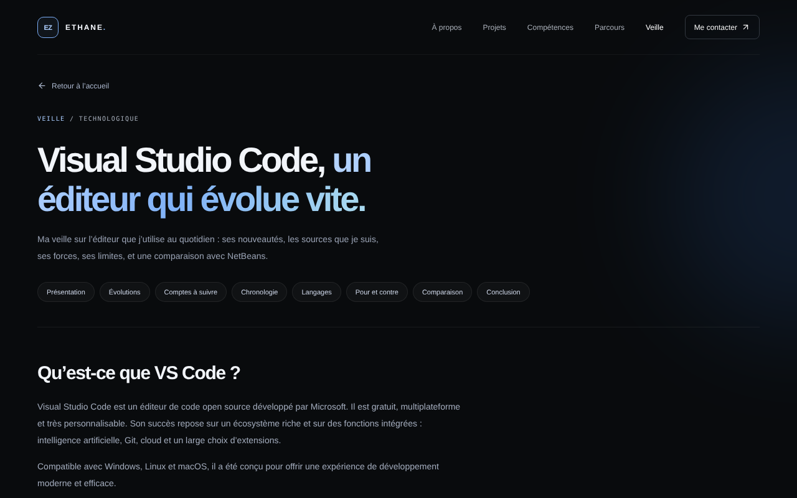
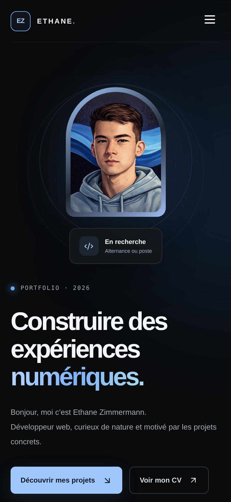

<div align="center">

# Portfolio · Ethane Zimmermann

**Développeur web · BTS SIO option SLAM**
Un portfolio sombre et soigné, construit avec React, TypeScript et Vite.


<!-- 🔗 Pour ajouter le lien du site en ligne : [Voir le portfolio](https://ton-adresse.vercel.app) -->


</div>

---

## Sommaire

- [À propos du projet](#à-propos-du-projet)
- [Aperçu](#aperçu)
- [Fonctionnalités](#fonctionnalités)
- [Technologies](#technologies)
- [Démarrer en local](#démarrer-en-local)
- [Modifier le contenu](#modifier-le-contenu)
- [Formulaire de contact](#formulaire-de-contact)
- [Mise en ligne](#mise-en-ligne)
- [Structure du projet](#structure-du-projet)
- [Contact](#contact)

---

## À propos du projet

Ce site est la refonte de mon [ancien portfolio](https://github.com/ZimEthane/PortFolio-BTS), réalisé en PHP avec CodeIgniter. L'objectif : repartir sur une base moderne (React + TypeScript), un design plus soigné et un site agréable à parcourir, aussi bien sur ordinateur que sur téléphone.

Il rassemble mes projets de formation, mes compétences, mon parcours, ma veille technologique et un moyen de me contacter, pour accompagner mes candidatures en alternance et en développement web.

## Aperçu

<table>
  <tr>
    <td width="68%" align="center"><br><sub>Page de veille technologique</sub></td>
    <td width="32%" align="center"><br><sub>Version mobile</sub></td>
  </tr>
</table>

## Fonctionnalités

| | |
|---|---|
| 🎨 **Thème sombre soigné** | Palette bleue, typographies Manrope et DM Mono, textes contrastés et lisibles |
| 🧭 **Navigation fluide** | Défilement animé vers chaque section, y compris quand le système réduit les animations |
| ⬆️ **Retour en haut** | Bouton flottant qui apparaît après un peu de défilement, avec remontée en douceur |
| 📱 **Responsive** | Mise en page adaptée au téléphone, à la tablette et à l'ordinateur, avec menu mobile |
| 🗂️ **Projets** | 7 réalisations avec leur documentation PDF, un lien vers les démos et les rapports de stage |
| 🧰 **Compétences et outils** | Langages, systèmes, logiciels et outils que j'utilise, regroupés par catégorie |
| 🎓 **Parcours** | Frise des stages, de la formation, des certifications, et présentation du BTS SIO (SLAM et SISR) |
| 📰 **Page de veille** | Veille technologique sur Visual Studio Code : nouveautés, sources, avantages et limites, comparaison avec NetBeans |
| 🎮 **Page Jeux** | 13 jeux jouables à la souris, au clavier et au doigt, présentés sur une page de garde avec un aperçu de chacun : Démineur, 2048, Sudoku, Puissance 4 (contre une IA ou à deux), Memory des technos, Snake, Blocs, Ninja (course sans fin à travers 8 mondes, avec 9 médailles à gagner), Glissières (500 niveaux), Pose-blocs, Labyrinthe (60 niveaux), Nonogramme (32 dessins et grilles aléatoires) et Relier les points (100 niveaux). Les niveaux sont générés par ordinateur puis vérifiés par un solveur. Guide « Comment jouer ? », records, sons, vibrations, plein écran sur téléphone, une adresse par jeu (`#jeux/2048`), et chaque jeu n’est chargé que quand on l’ouvre |
| 📚 **Page Tutos** *(en préparation, pas encore en ligne)* | Tutos pas à pas illustrés, pour petits et grands : faire ses lacets, résoudre le cube 3×3, choisir les composants de son PC. S'active avec `TUTOS_EN_LIGNE` dans `App.tsx` |
| ✉️ **Formulaire de contact** | Envoi par e-mail depuis le site, avec protection anti-robots et solution de secours |
| ♿ **Accessibilité** | Libellés pour les lecteurs d'écran, navigation au clavier, contrastes vérifiés |

## Technologies

- **[React 18](https://react.dev/)** pour l'interface
- **[TypeScript](https://www.typescriptlang.org/)** en mode strict
- **[Vite 6](https://vite.dev/)** pour le développement et la compilation
- **[Lucide](https://lucide.dev/)** pour les icônes
- **[EmailJS](https://www.emailjs.com/)** pour l'envoi du formulaire de contact
- **CSS** écrit à la main, sans framework

Le site n'utilise pas de bibliothèque de routage : la page de veille s'affiche grâce à l'ancre `#veille`, et le reste du site tient sur une seule page.

## Démarrer en local

**Prérequis :** [Node.js](https://nodejs.org/) en version LTS (20 ou plus récent).

```bash
# 1. Récupérer le projet
git clone https://github.com/ZimEthane/portfolio.git
cd portfolio/portfolio-dark-premium

# 2. Installer les dépendances
npm install

# 3. Lancer le site en mode développement
npm run dev
```

Ouvre ensuite l'adresse affichée dans le terminal, en général **http://localhost:5173**. Chaque modification du code met la page à jour automatiquement.

### Commandes utiles

| Commande | Rôle |
|---|---|
| `npm run dev` | Lance le site en mode développement |
| `npm run dev -- --host` | Idem, et rend le site visible depuis un téléphone sur le même Wi-Fi |
| `npm run build` | Vérifie les types et compile le site pour la production (dossier `dist`) |
| `npm run preview` | Affiche la version compilée, pour la tester avant la mise en ligne |

## Modifier le contenu

Presque tout le texte du site se trouve dans un seul fichier : **`src/data.ts`**.

| Je veux modifier… | Où |
|---|---|
| Mon e-mail, mon GitHub, mon LinkedIn | `CONTACT_EMAIL`, `GITHUB_URL`, `LINKEDIN_URL` en haut de `src/data.ts` |
| Un projet (titre, description, technologies, liens) | `projects` dans `src/data.ts` |
| Les noms des boutons d'un projet | `pdfLabel`, `demoLabel` et `extraPdf` dans la fiche du projet |
| Les compétences et les logiciels | `skills` et `toolGroups` |
| Les étapes du parcours | `timeline` |
| Le contenu de la page de veille | `veille` |
| La structure de la page d'accueil | `src/App.tsx` |
| Les couleurs et le style | `src/styles.css` (variables en haut du fichier) |

**Mon CV et mes documents** sont dans `public/pdf/`. Pour mettre à jour le CV, remplace `public/pdf/CV_Zimmermann_Ethane_2026.pdf` en gardant le même nom. **Les images** (photo, logos, icônes) sont dans `public/img/`.

## Formulaire de contact

Le formulaire envoie un e-mail grâce à [EmailJS](https://www.emailjs.com/), sans serveur à gérer. La configuration est dans `src/ContactForm.tsx` :

```ts
const SERVICE_ID = '…'
const TEMPLATE_ID = '…'
const PUBLIC_KEY = '…'
```

La clé publique est faite pour être visible dans le navigateur. Elle ne permet pas de lire les messages ou d'accéder au compte.

Côté EmailJS, vérifie trois choses :

1. Le modèle (template) envoie bien les messages vers ta boîte mail.
2. Il utilise les champs `name`, `email`, `Objet` et `message`.
3. Si tu as limité les domaines autorisés, l'adresse de ton site y figure.

Si l'envoi échoue, le visiteur voit un message d'erreur avec un lien pour t'écrire directement par e-mail.

## Mise en ligne

Le site est hébergé sur **[Vercel](https://vercel.com/)**, et chaque `git push` sur `main` le met à jour automatiquement.

Réglages du projet Vercel :

| Réglage | Valeur |
|---|---|
| Root Directory | `portfolio-dark-premium` |
| Framework Preset | Vite |
| Build Command | `npm run build` (par défaut) |
| Output Directory | `dist` (par défaut) |

Si l'accès demande une connexion Vercel, désactive **Vercel Authentication** dans *Settings → Deployment Protection*.

## Structure du projet

```text
portfolio/
├── docs/                         Captures d'écran utilisées dans ce README
└── portfolio-dark-premium/
    ├── public/
    │   ├── img/                  Photo, logos, icônes, certifications
    │   ├── pdf/                  CV, rapports de stage, documentations
    │   └── site_web_sport_extreme/   Mini-site du projet Sport Extrême
    ├── src/
    │   ├── App.tsx               Page d'accueil, menu, pied de page
    │   ├── Veille.tsx            Page de veille technologique
    │   ├── Jeux.tsx              Page Jeux (onglets des jeux)
    │   ├── jeux/                 Un fichier de logique et un composant par jeu
    │   │   └── commun/           Outils partagés : réglages, plein écran, vibrations, guide
    │   ├── Tutos.tsx             Page Tutos (liste et lecteur pas à pas)
    │   ├── tutos/                Liste des tutos et contenu de chacun
    │   ├── Chantier.tsx          Écran « en chantier » (pelleteuse animée)
    │   ├── ContactForm.tsx       Formulaire de contact (EmailJS)
    │   ├── scroll.ts             Défilement animé (menu et retour en haut)
    │   ├── data.ts               Contenu : projets, compétences, parcours, veille
    │   ├── styles.css            Styles du site
    │   └── main.tsx              Point d'entrée
    ├── index.html
    ├── package.json
    └── vite.config.ts
```

## Contact

**Ethane Zimmermann**, à la recherche d'une alternance ou d'un poste en développement web.

- 📧 [ethan.zim@hotmail.com](mailto:ethan.zim@hotmail.com)
- 💼 [LinkedIn](https://www.linkedin.com/in/ethane-zimmermann-509884326/)
- 🐙 [GitHub](https://github.com/ZimEthane)

<div align="center">
<sub>Conçu avec soin · React & TypeScript</sub>
</div>
